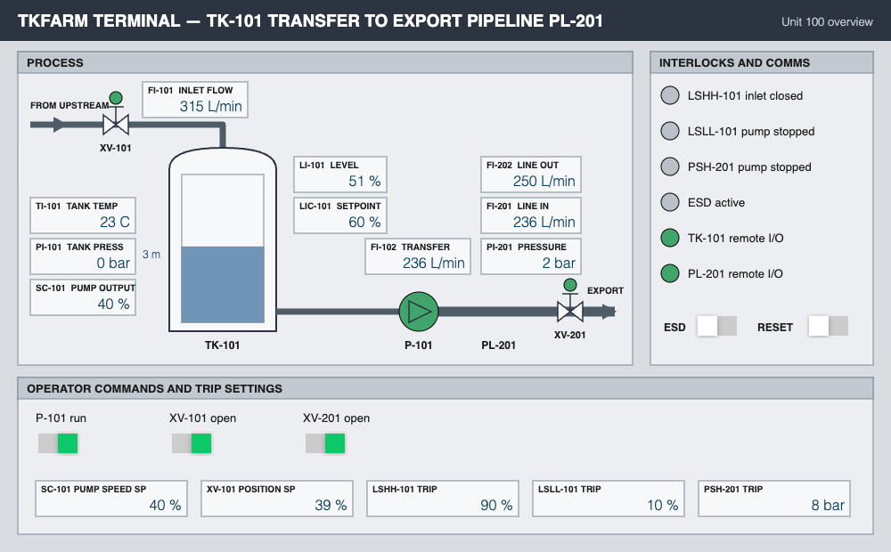

# otlab

A reproducible, on-demand OT/ICS security lab for a single Proxmox VE node. Four industrial scenarios, each in
its own disposable VM with Docker inside, nothing installed on the Proxmox host itself. Every scenario is
stopped by default, has no internet link unless you turn it on, and can be rolled back to a known-good snapshot.

| Scenario | What it simulates | Built on (pinned commit) | Upstream licence |
|---|---|---|---|
| oilgas | Tank farm transferring to an export pipeline; IT/DMZ/OT zones, OPC UA, historian | [iburres/otforge](https://github.com/iburres/otforge) process simulator `458fea7` + otlab's own controller and HMI | MIT |
| food | Food and beverage plant floor | [Gradiant/virtual-factory](https://github.com/Gradiant/virtual-factory) `4cb500d` | MPL-2.0 |
| chem | Chemical reactor (Tennessee Eastman) with a 3D plant view | [Fortiphyd/GRFICSv3](https://github.com/Fortiphyd/GRFICSv3) `754870d` | GPL-3.0 |
| elec | Distribution substation with DNP3 and Modbus field devices | [tonylturner/rangerdanger](https://github.com/tonylturner/rangerdanger) `v0.1.31` | Apache-2.0 |

otlab does not redistribute those projects. Each install clones the upstream repository at the pinned commit
(or pulls its published images by digest) inside the scenario VM and applies the changes listed below. See
`NOTICE` for credits. Scenario walk-throughs with screenshots, protocols, tags worth watching and a safe demo
for each are in `docs/scenarios/`.



## Safety

This is a training lab. The scenarios are deliberately weak in places, use upstream default logins, and two of
them can start an attacker box. Keep the lab on an isolated management VLAN, leave the internet link off, and do
not expose any of it to a network you care about.

## Requirements

- One Proxmox VE node (built on PVE 9) with about 16 GB RAM free and 250 GB on a ZFS or LVM-thin storage.
- A VLAN-aware bridge with a management VLAN, and a second VLAN that can reach the internet for installs.
- A Debian 13 cloud image for the base template.
- A workstation with an SSH client, `rsync` and `python3`, and root key access to the node.
- Optional: a physical Modbus/TCP PLC on its own L2-only VLAN (oilgas can show it read-only).

## Quick start

1. Copy `otlab.example.json` to `otlab.json` and edit it: node name, storage, VLAN tags, addresses, and which
   workstations may connect.
2. Put the public key of your workstation in `base/authorized_keys` (one key per line).
3. Run the following from the repo:

```bash
bin/otlab-host sync                     # copies the repo to /opt/otlab on the node
bin/otlab-host plan                     # shows what would be created; changes nothing
bin/otlab-host deploy base --image /var/lib/vz/template/debian-13-genericcloud-amd64.qcow2
base/bootstrap.sh <node-ip> <base-vm-ip> && bin/otlab-host seal-base
bin/otlab-host deploy oilgas            # internet on for the install, off again afterwards
bin/otlab-host test oilgas              # acceptance test
bin/otlab-host stop oilgas && bin/otlab-host baseline oilgas --confirm oilgas
bin/otlab-host start oilgas             # one scenario at a time
```

`docs/RUNBOOK.md` covers day-to-day use, port-forwards for each HMI, captures, reset and removal.
`otlab.json` and `base/authorized_keys` are git-ignored so your site details stay local.

## Changes from upstream

- chem (GRFICSv3 `754870d`, GPL-3.0): prebuilt Docker Hub images pinned by digest (`scenarios/chem/pins.yml`);
  macvlan parent is a dummy interface inside the VM; published ports bound to 127.0.0.1 (3D view moved to 8000);
  WireGuard publish removed; Docker socket mount removed from the simulation container; no auto-restart.
  Wazuh profile not installed.
- elec (RangerDanger tag `v0.1.31`, commit `0feef06`, Apache-2.0): release images pinned by digest, including
  the containd firewall that upstream floats on `latest`; no auto-restart; no pull at start. The backend keeps
  its Docker socket mount (upstream needs it); it is confined to the VM. The FUXA one-line diagram is otlab's own.
- food (virtual-factory `4cb500d`, MPL-2.0): simulators rebuilt with logging off and dependencies baked in;
  OpenSearch, the stats logger and the interactive anomaly injector are dropped. Details: `scenarios/food/README.md`.
- oilgas (OTForge `458fea7`, MIT, process-sim only): two simulator instances; one-line patch making the pipeline
  orifice coefficient configurable (`PIPELINE_CV_BASE`), because the hard-coded value gives about 0.02 bar at
  rated flow; base image pinned by digest. The controller (`scenarios/oilgas/plc/plc.py`) and the FUXA project
  generator are otlab's own code. The controller is a Python soft controller, not an IEC 61131 runtime.
  FUXA is rebuilt as `otlab/og-hmi:1` with its `modbus-serial` driver baked in: the upstream image ships without
  it, so its Modbus devices never polled.

## oilgas as a small production site

oilgas is meant to look like a running tank terminal to a passive monitoring tool, not only to pass exercises:

- **Process** (`plc/plc.py`): LIC-101 holds tank level by trimming the transfer pump (PI, bumpless auto/manual);
  upstream supply follows a daily curve plus a random walk; alarms with acknowledgement, heartbeat, daily totals,
  run hours and starts; rare upsets (supply surge, downstream restriction, level transmitter dropout, field comms
  blip). The controller syncs time over SNTP and sends alarms and upsets to syslog.
- **HMI** polls the controller in three block reads a second; a second screen carries alarms, modes and production.
- **Operator** (`og-ops`, ows01): a scripted shift operator working the plant through the HMI (acks, interlock
  resets, setpoint nudges, shift handover at 06:00/18:00, weekly pump check Tuesday 10:00), plus Windows-style
  NBNS, LLMNR and SSDP chatter.
- **OPC UA data server** (`og-opc`, opc01:4840): polls the controller and serves engineering-unit tags; the DMZ
  historian subscribes to it over OPC UA, so no Modbus crosses the firewall.
- **OT infrastructure** (`og-infra`, ot-svc01): DNS for `tkfarm.lan`, NTP, and a syslog collector
  (`/var/log/remote/<host>.log`).

Register map: docstring of `plc/plc.py`. Hostnames and addresses: `svc/hosts`.

## Known gaps

- The IT/DMZ overlay is built for oilgas, food and chem; elec uses RangerDanger's own enterprise and vendor zones.
- chem `--profile attack` (Kali, Caldera) is installed but untested.
- FUXA's own alarm list and trend charts are not configured on the oilgas and elec HMIs; alarms show as lamps.
- food: the conveyor cannot be stopped from the HMI.
- The chem acceptance test can fail if run in the first minute after an install (PLC healthy before it serves Modbus).
- Fidelity: oilgas is lumped first-order dynamics with controller-mediated coupling between tank and pipeline.
- Built and tested on one node only. The power on/off hook (`host.power` in `otlab.json`) has only been used
  with one setup.

## Layout

`bin/` CLI (`otlab` runs on the node, `otlab-host` on your workstation), `base/` template provisioning,
`scenarios/<name>/` installers, compose overrides, lock files and acceptance tests, `overlay/enterprise/` shared
IT/DMZ zones, `overlay/site/` DNS, NTP and syslog, `overlay/redteam/` attacker box, `tools/` helpers, `docs/`.

## Licence

otlab's own code is licensed as stated in `LICENSE`. The upstream projects keep their own licences; `NOTICE`
lists them and the one file here that is derived from an upstream file.
